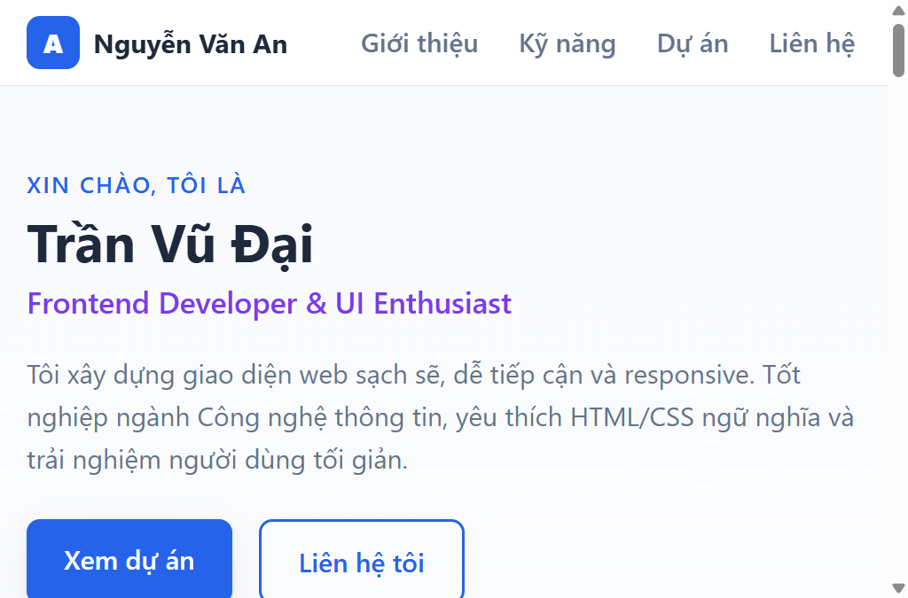
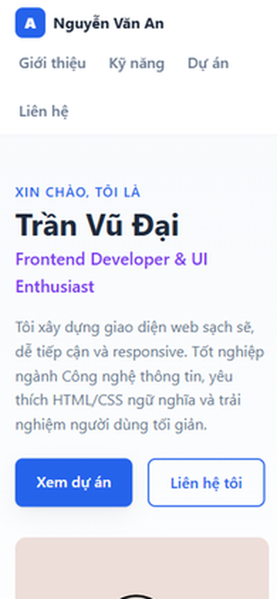
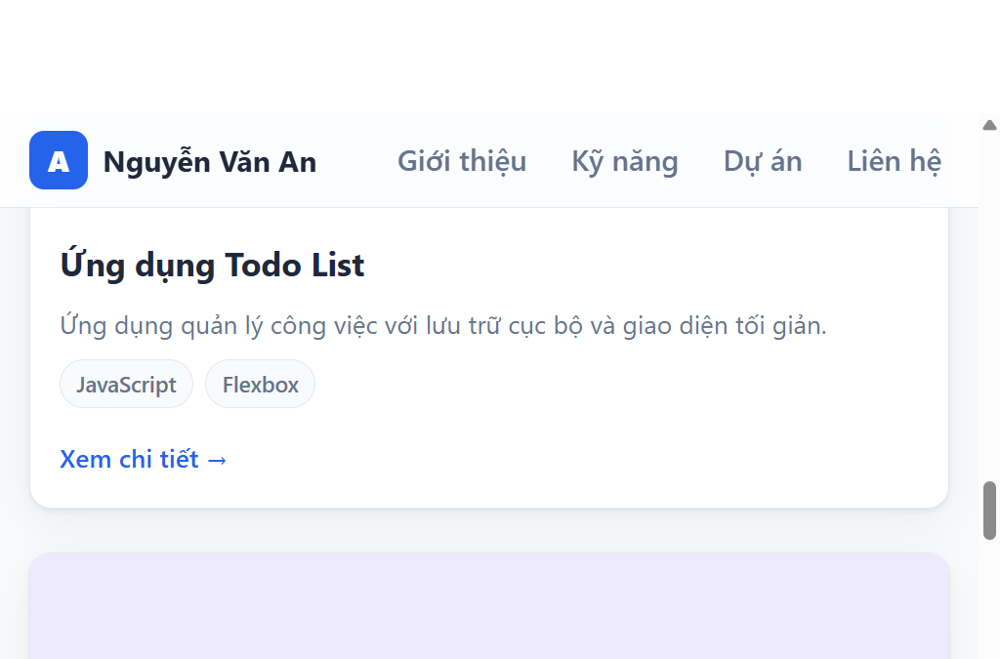

# Báo cáo kiểm thử

## Thông tin chung

- **Dự án:** Portfolio CV cá nhân – Frontend Developer
- **Phiên bản:** v1.0
- **Ngày kiểm thử:** 2026-10-27
- **Môi trường:** Windows, Python 3.12 (`http.server`), trình duyệt tích hợp.
- **Phạm vi:** Website tĩnh trong `index.html` và `assets/css/styles.css`.
- **Kết luận:** Trang tải được và tài nguyên chính hoạt động trên máy chủ cục bộ.
  Một số nội dung mẫu chưa đồng nhất; Docker và môi trường production chưa được
  kiểm chứng.

## Kết quả theo tiêu chí

| Tiêu chí | Kết quả | Kiểm tra và minh chứng |
|---|---|---|
| **Tính đúng đắn** | Đạt một phần | Trang có tiêu đề, bốn khu vực nội dung và các đích điều hướng; cả 5 ảnh tải thành công. Còn sai khác tên giữa phần thương hiệu/chân trang (“Nguyễn Văn An”), tiêu đề chính (“Trần Vũ Đại”) và văn bản thay thế ảnh. Có 6 liên kết `href="#"` chưa dẫn đến nội dung thật; email là dữ liệu mẫu. Xem ảnh [giao diện đầu trang](screenshots/portfolio-desktop.png) và [khu vực dự án](screenshots/portfolio-projects.png). |
| **UI/UX** | Đạt một phần | Giao diện có điều hướng, bố cục CSS responsive, trạng thái focus-visible và không có cuộn ngang tại viewport được kiểm tra. Có ảnh chụp giao diện ở cấu hình mobile. Công cụ trình duyệt báo viewport thực tế 546 × 360 px dù đã yêu cầu nhiều kích thước, vì vậy chưa xác nhận độc lập các breakpoint trên kích thước thiết bị thật. Xem [ảnh mobile](screenshots/portfolio-mobile.png). |
| **Khả năng vận hành – xử lý lỗi** | Đạt một phần | Chạy bằng `python -m http.server 8765`: trang HTML, stylesheet và ảnh đại diện đều trả HTTP 200; trình duyệt tải thành công toàn bộ ảnh. Trình duyệt yêu cầu `/favicon.ico` nhưng tệp chưa có nên máy chủ trả HTTP 404; đây không chặn trang nhưng tạo lỗi tài nguyên. Dự án không có backend, biểu mẫu hay JavaScript nên không có luồng xử lý lỗi máy chủ/người dùng để kiểm thử. |
| **Bảo mật** | Đạt kiểm tra tĩnh cơ bản | Không phát hiện thẻ script, tải tài nguyên script/style từ bên ngoài, biểu mẫu gửi dữ liệu hoặc thông tin bí mật được nhúng trong trang. Đây không phải kiểm thử xâm nhập; HTTPS, CSP, security headers, máy chủ production và phụ thuộc triển khai chưa được đánh giá. |
| **Chất lượng mã nguồn** | Đạt một phần | HTML có cấu trúc ngữ nghĩa và CSS được tách riêng, có media query và focus-visible. Phát hiện thẻ đóng `</style>` thừa trong phần `<head>`, nội dung tên/alt chưa đồng nhất và các liên kết placeholder. Chưa có lint hoặc kiểm thử tự động trong dự án. |
| **Khả năng triển khai** | Đạt cục bộ; chưa xác nhận production/Docker | Đã phục vụ trang và các tài nguyên tĩnh qua máy chủ HTTP cục bộ. Không xác nhận được Docker vì Docker daemon không khả dụng trong môi trường kiểm thử; chưa triển khai lên hosting hoặc máy chủ production. |

## Ảnh minh chứng

Ảnh được chụp từ trang chạy cục bộ trong trình duyệt và lưu trong thư mục
`docs/screenshots/`.

### Giao diện đầu trang

### Giao diện ở cấu hình mobile

### Khu vực dự án

